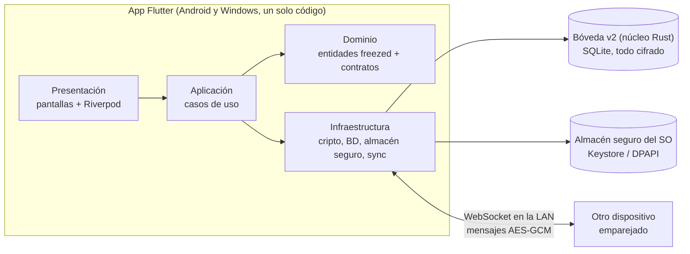

# Arquitectura de SoloKey (v1)

Cómo está hecha la app **hoy** (v1.1.0). Es el documento central: los demás de esta carpeta amplían un tema y las decisiones
con su porqué están en [`../adr/`](../adr/README.md). Si algo de aquí no coincide con el código, **manda el código** y se corrige
este archivo. La v2 cambia esto por fases: [`../diseno/REDISENO_V2.md`](../diseno/REDISENO_V2.md).

## 1. Vista general

- **Local-first, sin servidor ni cuentas** ([ADR-0001](../adr/0001-local-first-sin-nube.md)): nada sale del equipo salvo la sync
  P2P en la red local y la consulta opcional a HaveIBeenPwned (k-anonimato, solo 5 caracteres del SHA-1).
- **Solo infraestructura cifra**: presentación y dominio llaman a `ISecurityService`; nunca tocan claves ni bytes cifrados.

## 2. Capas y carpetas

| Capa | Dónde | Qué hay |
|---|---|---|
| Arranque y DI | `lib/main.dart`, `lib/app/` | `runZonedGuarded`, get_it + injectable (`app/di/`), puente get_it a Riverpod (`provider_overrides.dart`) |
| Rutas | `lib/router/` | go_router 18; guard que manda a `/unlock` si la sesión está bloqueada |
| Tema | `lib/theme/` | Tinta y papel (DIS-1): `app_palette.dart` (color por rol, claro y oscuro), `app_tokens.dart` (espacio, esquinas, sombra, movimiento), `app_theme.dart` (claro, oscuro y sistema; Atkinson Hyperlegible) |
| Compartido | `lib/shared/` | Widgets comunes, teclado seguro, extensiones |
| Núcleo | `lib/core/` | `domain/`, `infrastructure/` (security, database, clipboard), `services/` (export, import, auditoría, recuperación, backups, notificaciones), `presentation/` |
| Funciones | `lib/features/<f>/{domain,application,infrastructure,presentation}` | autofill, credentials, folders, passkeys, password_generator, secure_files, settings, sync, vault_access, vault_transfer |
| Idiomas | `lib/l10n/` | ARB es/en, plantilla `app_es.arb` (español fuente, PAN-10); sin traducción, cae al inglés |

Reglas: modelos inmutables (freezed); un caso de uso por acción; los widgets no llaman a get_it salvo en el arranque.

## 3. Criptografía

| Pieza | Cómo | Dónde |
|---|---|---|
| Derivación de la clave | Argon2id, 64 MiB, 3 iteraciones, paralelismo 4, 32 bytes; sal de 32 bytes por bóveda. Parámetros acotados (SEC-012) | Núcleo Rust: `rust/solokey-core/src/crypto.rs` (crate `argon2`) |
| Cifrado | AES-256-GCM, nonce aleatorio de 12 bytes por operación; blob `nonce ‖ ciphertext ‖ tag` | Núcleo Rust (crate `aes-gcm`); lo que entra se pone a cero (`zeroize`) |
| Puente | `SecurityServiceImpl` llama al núcleo por `flutter_rust_bridge` 2 (NUC-1); corre en el pool de hilos del puente y la interfaz no se bloquea. Lo carga `initRustCore()` desde `configureDependencies` | `security_service_impl.dart`, `rust_core.dart`, `lib/core/infrastructure/rust/` (generado) |
| Librerías nativas | `solokey_core.dll` (cruzada con `cargo-xwin`) y `libsolokey_core.so` por ABI (`cargo-ndk`) en `rust/dist/`, sin versionar: `.\tool\build.ps1 -Nucleo -Salida rust\dist`. CMake copia la DLL junto al `.exe` y Gradle toma `jniLibs/`; los dos fallan con un aviso si falta. El puente se regenera con `.\rust\puente.ps1` | `windows/CMakeLists.txt`, `android/app/build.gradle.kts` |
| Verificar la maestra | La clave de la bóveda (DEK) va envuelta con la de la maestra: si no abre, la maestra es incorrecta. Ni la contraseña ni su hash se guardan | Núcleo: `vault.rs` (§4.1) |
| Clave en RAM | Vive en el núcleo (`Zeroizing`); `SessionManager` guarda solo el `VaultHandle` y bloquear lo cierra (el núcleo pone a cero la clave y el índice). `keyCopy()` da una copia solo para guardar la de la biometría y se borra tras usarse | `session_manager.dart`, `vault_store.dart` |
| Doble sobre | Registros marcados se cifran otra vez con su propio Argon2id + AES-GCM; revelar pide re-autenticación | `double_envelope_service.dart` |
| Recuperación | Código mostrado una vez; envuelve la DEK en la cabecera. Paso 1 lo comprueba (`vaultCheckRecovery`), paso 2 pone la maestra nueva (`vaultRecover`) sin re-cifrar nada | `recovery_service.dart`, núcleo |
| Fuerza bruta | Retardos crecientes y borrado de la bóveda tras N intentos (configurable) | `brute_force_guard.dart` |

Por qué estos parámetros: [ADR-0003](../adr/0003-cifrado-de-la-boveda.md).

## 4. Datos

| Qué | Dónde | Cifrado |
|---|---|---|
| Credenciales, carpetas, categorías, historial | Registros de la bóveda v2 (§4.1) por `VaultStore` y los repositorios | Todo cifrado con la DEK; en claro solo id y versión |
| Archivos seguros | `blobs` de la bóveda, con el mismo id que su registro | Cifrados con la DEK; la vista previa solo en RAM |
| Agenda de rotación | `rotacion.json` en el directorio de datos (`rotation_schedule.dart`) | Sin secretos: id, vencimiento y último aviso; la lee el aviso de fondo sin la maestra |
| Ajustes y llaves | `flutter_secure_storage` (Keystore en Android, DPAPI en Windows) | Ajustes de seguridad, clave de la biometría (la DEK, SEC-010), `K_sync` de cada par |

Directorio de datos (`data_location.dart`): el de soporte de la app. Con `--dart-define=SOLOKEY_DATA_DIR=<ruta>` (NUC-6; relativa =
bajo el soporte; un release lo ignora) todo va a esa carpeta, también la v1 a migrar y un almacén en archivo (`FileSecureStorage`
en lugar del del sistema): así las E2E no tocan la bóveda real.

La v1 (drift `vault_guard_db`, esquema v10, en Documentos, más `secure_files/` en el soporte) solo se lee para migrarla; drift ya no
está en la app. **Cambiar el formato exige vectores de prueba** que demuestren que una bóveda anterior se sigue abriendo: los de
la v1 están en
[`vectores/v1/`](../../vectores/v1/LEEME.md) (CAL-2), con sus rarezas (la maestra entra a Argon2id con doble codificación UTF-8). Por qué así: [ADR-0005](../adr/0005-datos-en-sqlite-con-payload-cifrado.md).

### 4.1 Formato de la bóveda v2 (núcleo Rust, NUC-2)

Lo define y lo maneja `rust/solokey-core/src/vault.rs` ([ADR-0009](../adr/0009-formato-de-boveda-v2.md)). La app lo usa desde
NUC-2 por `VaultStore` (`lib/core/infrastructure/vault/`); el handle abierto vive en `SessionManager`.

| Pieza | Cómo |
|---|---|
| Archivo | `solokey.vault` (SQLite por `rusqlite`) en el directorio de datos que pasa Flutter; `application_id` `SKV2`, `user_version` 2 |
| `header` (una fila, en claro) | Versión del formato, id de la bóveda, Argon2id y sus parámetros, sal, y la **DEK** (32 bytes aleatorios) envuelta dos veces: `key_by_master` (clave de la maestra) y `key_by_recovery` (código), más `key_check` para abrir con la DEK (biometría) |
| `records` | En claro solo `id` y `version` (del sobre, hoy 1). El resto es un sobre JSON `{kind, updatedAt, deleted, data}` con AES-256-GCM y la DEK; el AAD lleva versión e id, así que una fila copiada en otra no abre |
| `blobs` | Contenido de los archivos seguros, cifrado con la DEK y atado a su id |
| Tipos (`kind`) | `credential`, `folder`, `category`, `history`, `file`; los que empiezan por `_` son locales del equipo y la sync no los manda |
| Al abrir | Se descifran todos los sobres a un índice en RAM (`Zeroizing`); se pone a cero al cerrar |
| Maestra y código | Cambiar la maestra o recuperar con el código solo re-envuelve la DEK: no se re-cifra nada y no se pierde nada (cierra SEC-009). El código es base64 sin `=` en grupos de 4 con guiones, como en la v1 |
| Borrados | Lápida (`deleted`, `data` = `null`) para que la sync propague; `purge` borra sin rastro. `PRAGMA secure_delete` encendido |
| `data` | El JSON de la entidad de Dart en camelCase. Credencial = columnas de la v1 + su payload en un solo objeto (la carpeta sigue en `categoryId`); historial = foto del payload + `credentialId` |

**Migración única desde la v1** (`migrate_v1.rs`): verifica la maestra (con la doble UTF-8), copia la v1 entera a un directorio de
respaldo y la comprueba por hash, lee **la copia**, escribe la v2 en `solokey.vault.migrando` con una DEK nueva, la reabre con la
maestra y compara cada registro y cada archivo con la v1; solo entonces la renombra y retira los originales (la copia se queda). Si
algo falla, la v1 queda intacta y no hay v2. La maestra de la v2 entra en UTF-8 simple. El código de recuperación de la v1 no sirve
en la v2: la bóveda migrada nace sin código y la app pide generar uno.

En la app, la migración corre al primer desbloqueo con la maestra (`VaultStore.open`) si hay v1 y no v2. Después borra del almacén
seguro las claves de la v1 (config, metadatos, recuperación, biometría y la clave envuelta del desbloqueo por WiFi, que hay que
volver a registrar) y deja `recovery_reset_needed` si la v1 tenía código. La E2E `migracion_v1_test.dart` lo prueba con los
vectores de CAL-2.

## 5. Sincronización P2P

| Paso | Cómo |
|---|---|
| Emparejar | El escritorio levanta un servidor WebSocket (Shelf) desde el puerto 8283 y muestra el QR v2 `{v:2, ip, port, token, pub}`: su llave estática Noise y un token de **un uso que caduca a los 10 min** (otro celular, QR nuevo) |
| Canal | Noise IK del núcleo (§5.1): el celular manda `{id, name, token}` cifrado en el primer mensaje; el escritorio fija la llave del celular (`solokey_sync2_peers`) y el celular la del escritorio (`solokey_sync2_desktop`). La identidad de cada equipo vive en `solokey_sync2_identity` |
| Transporte | `ws://` binario en la LAN con **todo el canal cifrado**; en claro solo el saludo `SKS2` y el descubrimiento. Por conexión, una cola (`_Link.serial`) mantiene el orden de las tramas |
| Reconectar | Sin QR: el mismo IK con la llave ya fijada; latido de 20 s y reconexión automática |
| Mensajes | Byte 0 = delta del núcleo, 1 = control JSON (`remote_unlock_token`, `approval_request`, `sync_request`, `wifi_unlock`, `ping`...). Cualquiera arranca una ronda (`SyncSession.start`); el otro contesta solo (`onFrame` + `process`). Un par v1 recibe el aviso y no se mezcla nada |
| Desbloqueo remoto | El escritorio guarda su clave envuelta con un token (DUK) que tiene el celular; el celular lo manda por el canal (`wifi_unlock`) y el escritorio abre con `vaultOpenWithKey`. La contraseña nunca viaja |

Diseño original con diagramas: [`SYNC_P2P.md`](SYNC_P2P.md) (plan de junio de la v1; donde difiera, manda esta tabla).
Una v1 y una v2 no sincronizan: hay que actualizar los dos y volver a emparejar. Por qué así: [ADR-0006](../adr/0006-sync-p2p-en-la-lan.md).

### 5.1 Núcleo de la sync (Rust, NUC-3)

`rust/solokey-core/src/sync/` ([ADR-0010](../adr/0010-sync-v2-canal-cifrado.md)), **sin E/S**: Flutter mueve los bytes (WebSocket
binario, descubrimiento, QR) y guarda la identidad del equipo y las llaves fijadas de sus pares en el almacén seguro.

| Pieza | Cómo |
|---|---|
| Patrón | `Noise_IK_25519_ChaChaPoly_SHA256` (crate `snow`), prólogo `SoloKey sync v2` |
| Por qué `IK` | Quien escanea el QR ya tiene la llave estática del otro: lo autentica desde el primer mensaje y nadie en medio puede suplantarlo. Su propia llave viaja cifrada en ese mensaje; el otro la acepta si trae el token de un uso del QR (emparejar) o si ya la tiene fijada (reconectar). Un patrón para los dos casos, sin certificados |
| Versión | Las dos tramas del saludo empiezan con `SKS2` + versión (2) en claro. Una trama JSON es la v1, otra versión se rechaza: los datos no se mezclan y la app dice que hay que actualizar los dos (`PeerIsV1`, `PeerVersion`) |
| Canal | Todo va cifrado y autenticado; un mensaje largo se parte en tramas de 64 KiB como mucho y se junta (tope 256 MiB). Una trama alterada o repetida se rechaza |
| Delta | Cada lado manda `Summary` (id, fecha, lápida y SHA-256 de los datos), luego un `Push` con lo que gana (y el contenido de los archivos), y aplica lo que gana del otro. Los registros `_…` no viajan |
| LWW | Gana la fecha más nueva; con la misma fecha gana la lápida y después el hash mayor. Determinista: los dos equipos eligen lo mismo (en la v1 el empate comparaba el id consigo mismo y cada equipo se quedaba con lo suyo) |
| Fechas | Se guardan tal cual las puso el equipo de origen |

## 6. Plataformas

| Plataforma | Qué tiene propio |
|---|---|
| Android | Autofill del sistema (`AutofillService`, canal `com.solokey/autofill`), `FLAG_SECURE`, WorkManager para la rotación, cámara para QR |
| Windows | Instancia única, bandeja, autoarranque, Windows Hello, atajos globales, Quick-Fill por portapapeles, captura de QR de la pantalla, instalador Inno Setup |
| macOS, Linux, iOS | Sin empaquetar (PLA-2); guía de iOS en [`../publicacion/IOS.md`](../publicacion/IOS.md) |

Rotación de contraseñas (fondo en ambas plataformas, sin descifrar): [`ROTACION.md`](ROTACION.md). Un solo código para las dos:
[ADR-0004](../adr/0004-un-solo-codigo-flutter.md). Calidad y CI: [ADR-0007](../adr/0007-red-de-calidad-y-ci.md).
