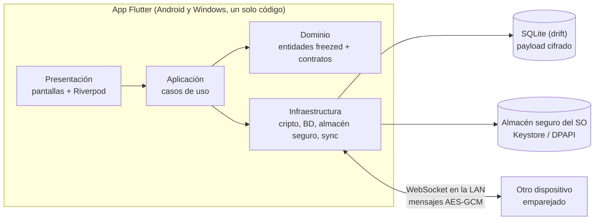

# Arquitectura de SoloKey (v1)

Cómo está hecha la app **hoy** (v1.1.0). Es el documento central: los demás de esta carpeta amplían un tema y las decisiones
con su porqué están en [`../adr/`](../adr/README.md). Si algo de aquí no coincide con el código, **manda el código** y se corrige
este archivo. La v2 cambia esto por fases: [`../diseno/REDISENO_V2.md`](../diseno/REDISENO_V2.md).

## 1. Vista general

- **Local-first, sin servidor ni cuentas** ([ADR-0001](../adr/0001-local-first-sin-nube.md)): nada sale del equipo salvo la sync
  P2P en la red local y la consulta opcional a HaveIBeenPwned (k-anonimato, solo 5 caracteres del SHA-1).
- **Solo infraestructura cifra**: presentación y dominio llaman a `ISecurityService`; nunca tocan claves ni bytes cifrados.

## 2. Capas y carpetas

| Capa | Dónde | Qué hay |
|---|---|---|
| Arranque y DI | `lib/main.dart`, `lib/app/` | `runZonedGuarded`, get_it + injectable (`app/di/`), puente get_it a Riverpod (`provider_overrides.dart`) |
| Rutas | `lib/router/` | go_router 18; guard que manda a `/unlock` si la sesión está bloqueada |
| Tema | `lib/theme/` | Tinta y papel (DIS-1): `app_palette.dart` (color por rol, claro y oscuro), `app_tokens.dart` (espacio, esquinas, sombra, movimiento), `app_theme.dart` (claro, oscuro y sistema; Atkinson Hyperlegible) |
| Compartido | `lib/shared/` | Widgets comunes, teclado seguro, extensiones |
| Núcleo | `lib/core/` | `domain/`, `infrastructure/` (security, database, clipboard), `services/` (export, import, auditoría, recuperación, backups, notificaciones), `presentation/` |
| Funciones | `lib/features/<f>/{domain,application,infrastructure,presentation}` | autofill, credentials, folders, passkeys, password_generator, secure_files, settings, sync, vault_access, vault_transfer |
| Idiomas | `lib/l10n/` | ARB es/en, plantilla `app_es.arb` (español fuente, PAN-10); sin traducción, cae al inglés |

Reglas: modelos inmutables (freezed); un caso de uso por acción; los widgets no llaman a get_it salvo en el arranque.

## 3. Criptografía

| Pieza | Cómo | Dónde |
|---|---|---|
| Derivación de la clave | Argon2id, 64 MiB, 3 iteraciones, paralelismo 4, 32 bytes; sal de 32 bytes por bóveda. Parámetros acotados (SEC-012) | Núcleo Rust: `rust/solokey-core/src/crypto.rs` (crate `argon2`) |
| Cifrado | AES-256-GCM, nonce aleatorio de 12 bytes por operación; blob `nonce ‖ ciphertext ‖ tag` | Núcleo Rust (crate `aes-gcm`); lo que entra se pone a cero (`zeroize`) |
| Puente | `SecurityServiceImpl` llama al núcleo por `flutter_rust_bridge` 2 (NUC-1); corre en el pool de hilos del puente y la interfaz no se bloquea. Lo carga `initRustCore()` desde `configureDependencies` | `security_service_impl.dart`, `rust_core.dart`, `lib/core/infrastructure/rust/` (generado) |
| Librerías nativas | `solokey_core.dll` (cruzada con `cargo-xwin`) y `libsolokey_core.so` por ABI (`cargo-ndk`) en `rust/dist/`, sin versionar: `.\tool\build.ps1 -Nucleo -Salida rust\dist`. CMake copia la DLL junto al `.exe` y Gradle toma `jniLibs/`; los dos fallan con un aviso si falta. El puente se regenera con `.\rust\puente.ps1` | `windows/CMakeLists.txt`, `android/app/build.gradle.kts` |
| Verificar la maestra | Se descifra un dato de prueba (`verificationData`); la contraseña ni su hash se guardan | `MasterKeyConfig` |
| Clave en RAM | `SessionManager` la guarda en `Uint8List`, la pone a cero al bloquear; `getKeyCopy()` da copias que se borran tras usarse | `session_manager.dart` |
| Doble sobre | Registros marcados se cifran otra vez con su propio Argon2id + AES-GCM; revelar pide re-autenticación | `double_envelope_service.dart` |
| Recuperación | Código de 32 bytes mostrado una vez; se guarda su SHA-256 y la clave maestra cifrada con él | `recovery_service.dart` |
| Fuerza bruta | Retardos crecientes y borrado de la bóveda tras N intentos (configurable) | `brute_force_guard.dart` |

Por qué estos parámetros: [ADR-0003](../adr/0003-cifrado-de-la-boveda.md).

## 4. Datos

| Qué | Dónde | Cifrado |
|---|---|---|
| Credenciales | drift `CredentialEntries` | Todo lo sensible en un payload JSON cifrado (BLOB); en claro solo id, tipo, carpeta, favorito, oculto, orden, fechas y lo de rotación |
| Carpetas, categorías | `FolderEntries`, `CategoryEntries` | Nombres en claro (decisión de la v1; en la v2 van cifrados, [ADR-0009](../adr/0009-formato-de-boveda-v2.md)) |
| Historial de contraseñas | `PasswordHistoryEntries` | Cifrado |
| Archivos seguros | `SecureFileEntries` + archivos en `getApplicationSupportDirectory()` | Cifrados en reposo; la vista previa solo en RAM |
| Configuración de la bóveda | `flutter_secure_storage` (Keystore en Android, DPAPI en Windows) | `MasterKeyConfig`, ajustes de seguridad, `K_sync` de cada par |

BD `vault_guard_db`, esquema **v10** (`app_database.dart`), con migraciones paso a paso. **Cambiar el formato exige vectores de
prueba** que demuestren que una bóveda anterior se sigue abriendo: los de la v1 están en
[`vectores/v1/`](../../vectores/v1/LEEME.md) (CAL-2), con sus rarezas (la maestra entra a Argon2id con doble codificación UTF-8). Por qué así: [ADR-0005](../adr/0005-datos-en-sqlite-con-payload-cifrado.md).

### 4.1 Formato de la bóveda v2 (núcleo Rust, NUC-2)

Lo define y lo maneja `rust/solokey-core/src/vault.rs` ([ADR-0009](../adr/0009-formato-de-boveda-v2.md)). La app todavía usa la v1
de arriba hasta que entre el puente a Dart.

| Pieza | Cómo |
|---|---|
| Archivo | `solokey.vault` (SQLite por `rusqlite`) en el directorio de datos que pasa Flutter; `application_id` `SKV2`, `user_version` 2 |
| `header` (una fila, en claro) | Versión del formato, id de la bóveda, Argon2id y sus parámetros, sal, y la **DEK** (32 bytes aleatorios) envuelta dos veces: `key_by_master` (clave de la maestra) y `key_by_recovery` (código), más `key_check` para abrir con la DEK (biometría) |
| `records` | En claro solo `id` y `version` (del sobre, hoy 1). El resto es un sobre JSON `{kind, updatedAt, deleted, data}` con AES-256-GCM y la DEK; el AAD lleva versión e id, así que una fila copiada en otra no abre |
| `blobs` | Contenido de los archivos seguros, cifrado con la DEK y atado a su id |
| Tipos (`kind`) | `credential`, `folder`, `category`, `history`, `file`; los que empiezan por `_` son locales del equipo y la sync no los manda |
| Al abrir | Se descifran todos los sobres a un índice en RAM (`Zeroizing`); se pone a cero al cerrar |
| Maestra y código | Cambiar la maestra o recuperar con el código solo re-envuelve la DEK: no se re-cifra nada y no se pierde nada (cierra SEC-009). El código es base64 sin `=` en grupos de 4 con guiones, como en la v1 |
| Borrados | Lápida (`deleted`, `data` = `null`) para que la sync propague; `purge` borra sin rastro. `PRAGMA secure_delete` encendido |
| `data` | El JSON de la entidad de Dart en camelCase. Credencial = columnas de la v1 + su payload en un solo objeto (la carpeta sigue en `categoryId`); historial = foto del payload + `credentialId` |

**Migración única desde la v1** (`migrate_v1.rs`): verifica la maestra (con la doble UTF-8), copia la v1 entera a un directorio de
respaldo y la comprueba por hash, lee **la copia**, escribe la v2 en `solokey.vault.migrando` con una DEK nueva, la reabre con la
maestra y compara cada registro y cada archivo con la v1; solo entonces la renombra y retira los originales (la copia se queda). Si
algo falla, la v1 queda intacta y no hay v2. La maestra de la v2 entra en UTF-8 simple. El código de recuperación de la v1 no sirve
en la v2: la bóveda migrada nace sin código y la app pide generar uno.

## 5. Sincronización P2P

| Paso | Cómo |
|---|---|
| Emparejar | El escritorio levanta un servidor WebSocket (Shelf) desde el puerto 8283 y muestra un QR con IP, puerto, token de un uso y su llave pública X25519 |
| Acordar la llave | ECDH X25519 autenticado con HMAC-SHA256 sobre el token: `K_sync` por dispositivo, guardada en el almacén seguro |
| Transporte | `ws://` en la LAN; **cada mensaje va cifrado con AES-256-GCM y `K_sync`** (el canal en sí no tiene TLS) |
| Reconectar | Sin QR: reto HMAC con la `K_sync` guardada; latido y reconexión automática |
| Delta | Intercambio de estado; gana la última escritura (fecha, desempate por UUID); credenciales, carpetas y archivos seguros (re-cifrados por dispositivo) |
| Desbloqueo remoto | El celular aprueba y envía la clave maestra envuelta por el canal; la contraseña nunca viaja |

Diseño original con diagramas: [`SYNC_P2P.md`](SYNC_P2P.md) (plan de junio; donde difiera, por ejemplo el TLS con certificado
fijado que no se construyó, manda esta tabla). Por qué así: [ADR-0006](../adr/0006-sync-p2p-en-la-lan.md).

### 5.1 Sync v2 (núcleo Rust, NUC-3)

`rust/solokey-core/src/sync/` ([ADR-0010](../adr/0010-sync-v2-canal-cifrado.md)), **sin E/S**: Flutter mueve los bytes (WebSocket
binario, descubrimiento, QR) y guarda la identidad del equipo y las llaves fijadas de sus pares en el almacén seguro.

| Pieza | Cómo |
|---|---|
| Patrón | `Noise_IK_25519_ChaChaPoly_SHA256` (crate `snow`), prólogo `SoloKey sync v2` |
| Por qué `IK` | Quien escanea el QR ya tiene la llave estática del otro: lo autentica desde el primer mensaje y nadie en medio puede suplantarlo. Su propia llave viaja cifrada en ese mensaje; el otro la acepta si trae el token de un uso del QR (emparejar) o si ya la tiene fijada (reconectar). Un patrón para los dos casos, sin certificados |
| Versión | Las dos tramas del saludo empiezan con `SKS2` + versión (2) en claro. Una trama JSON es la v1, otra versión se rechaza: los datos no se mezclan y la app dice que hay que actualizar los dos (`PeerIsV1`, `PeerVersion`) |
| Canal | Todo va cifrado y autenticado; un mensaje largo se parte en tramas de 64 KiB como mucho y se junta (tope 256 MiB). Una trama alterada o repetida se rechaza |
| Delta | Cada lado manda `Summary` (id, fecha, lápida y SHA-256 de los datos), luego un `Push` con lo que gana (y el contenido de los archivos), y aplica lo que gana del otro. Los registros `_…` no viajan |
| LWW | Gana la fecha más nueva; con la misma fecha gana la lápida y después el hash mayor. Determinista: los dos equipos eligen lo mismo (en la v1 el empate comparaba el id consigo mismo y cada equipo se quedaba con lo suyo) |
| Fechas | Se guardan tal cual las puso el equipo de origen |

## 6. Plataformas

| Plataforma | Qué tiene propio |
|---|---|
| Android | Autofill del sistema (`AutofillService`, canal `com.solokey/autofill`), `FLAG_SECURE`, WorkManager para la rotación, cámara para QR |
| Windows | Instancia única, bandeja, autoarranque, Windows Hello, atajos globales, Quick-Fill por portapapeles, captura de QR de la pantalla, instalador Inno Setup |
| macOS, Linux, iOS | Sin empaquetar (PLA-2); guía de iOS en [`../publicacion/IOS.md`](../publicacion/IOS.md) |

Rotación de contraseñas (fondo en ambas plataformas, sin descifrar): [`ROTACION.md`](ROTACION.md). Un solo código para las dos:
[ADR-0004](../adr/0004-un-solo-codigo-flutter.md). Calidad y CI: [ADR-0007](../adr/0007-red-de-calidad-y-ci.md).
