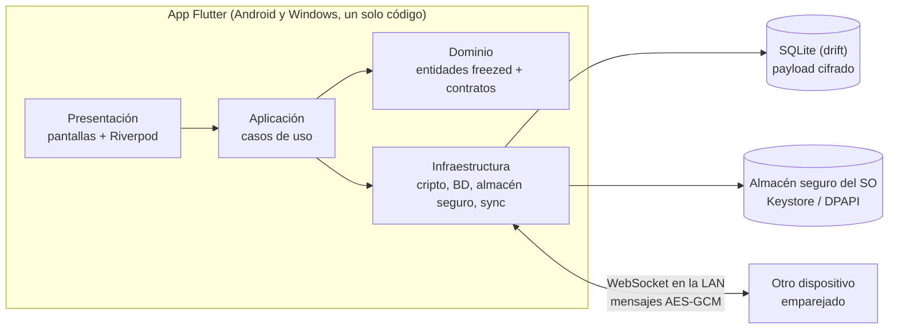

# Arquitectura de SoloKey (v1)

Cómo está hecha la app **hoy** (v1.1.0). Es el documento central: los demás de esta carpeta amplían un tema y las decisiones
con su porqué están en [`../adr/`](../adr/README.md). Si algo de aquí no coincide con el código, **manda el código** y se corrige
este archivo. La v2 cambia esto por fases: [`../diseno/REDISENO_V2.md`](../diseno/REDISENO_V2.md).

## 1. Vista general

- **Local-first, sin servidor ni cuentas** ([ADR-0001](../adr/0001-local-first-sin-nube.md)): nada sale del equipo salvo la sync
  P2P en la red local y la consulta opcional a HaveIBeenPwned (k-anonimato, solo 5 caracteres del SHA-1).
- **Solo infraestructura cifra**: presentación y dominio llaman a `ISecurityService`; nunca tocan claves ni bytes cifrados.

## 2. Capas y carpetas

| Capa | Dónde | Qué hay |
|---|---|---|
| Arranque y DI | `lib/main.dart`, `lib/app/` | `runZonedGuarded`, get_it + injectable (`app/di/`), puente get_it a Riverpod (`provider_overrides.dart`) |
| Rutas | `lib/router/` | go_router 14; guard que manda a `/unlock` si la sesión está bloqueada |
| Tema | `lib/theme/` | Tokens y temas de la v1 (Graphite Pro: dark, light, dim, oled) |
| Compartido | `lib/shared/` | Widgets comunes, teclado seguro, extensiones |
| Núcleo | `lib/core/` | `domain/`, `infrastructure/` (security, database, clipboard), `services/` (export, import, auditoría, recuperación, backups, notificaciones), `presentation/` |
| Funciones | `lib/features/<f>/{domain,application,infrastructure,presentation}` | autofill, credentials, folders, passkeys, password_generator, secure_files, settings, sync, vault_access, vault_transfer |
| Idiomas | `lib/l10n/` | ARB es/en, plantilla `app_en.arb` |

Reglas: modelos inmutables (freezed); un caso de uso por acción; los widgets no llaman a get_it salvo en el arranque.

## 3. Criptografía

| Pieza | Cómo | Dónde |
|---|---|---|
| Derivación de la clave | Argon2id, 64 MiB, 3 iteraciones, paralelismo 4, 32 bytes; sal de 32 bytes por bóveda | `crypto_isolate.dart` |
| Cifrado | AES-256-GCM, nonce aleatorio de 12 bytes por operación; blob `nonce ‖ ciphertext ‖ tag` | `crypto_isolate.dart` |
| Hilo | Todo lo costoso en `Isolate.run`; la interfaz no se bloquea | `security_service_impl.dart` |
| Verificar la maestra | Se descifra un dato de prueba (`verificationData`); la contraseña ni su hash se guardan | `MasterKeyConfig` |
| Clave en RAM | `SessionManager` la guarda en `Uint8List`, la pone a cero al bloquear; `getKeyCopy()` da copias que se borran tras usarse | `session_manager.dart` |
| Doble sobre | Registros marcados se cifran otra vez con su propio Argon2id + AES-GCM; revelar pide re-autenticación | `double_envelope_service.dart` |
| Recuperación | Código de 32 bytes mostrado una vez; se guarda su SHA-256 y la clave maestra cifrada con él | `recovery_service.dart` |
| Fuerza bruta | Retardos crecientes y borrado de la bóveda tras N intentos (configurable) | `brute_force_guard.dart` |

Por qué estos parámetros: [ADR-0003](../adr/0003-cifrado-de-la-boveda.md).

## 4. Datos

| Qué | Dónde | Cifrado |
|---|---|---|
| Credenciales | drift `CredentialEntries` | Todo lo sensible en un payload JSON cifrado (BLOB); en claro solo id, tipo, carpeta, favorito, oculto, orden, fechas y lo de rotación |
| Carpetas, categorías | `FolderEntries`, `CategoryEntries` | Nombres en claro (decisión de la v1, revisar en la v2) |
| Historial de contraseñas | `PasswordHistoryEntries` | Cifrado |
| Archivos seguros | `SecureFileEntries` + archivos en `getApplicationSupportDirectory()` | Cifrados en reposo; la vista previa solo en RAM |
| Configuración de la bóveda | `flutter_secure_storage` (Keystore en Android, DPAPI en Windows) | `MasterKeyConfig`, ajustes de seguridad, `K_sync` de cada par |

BD `vault_guard_db`, esquema **v10** (`app_database.dart`), con migraciones paso a paso. **Cambiar el formato exige vectores de
prueba** que demuestren que una bóveda anterior se sigue abriendo (CAL-2). Por qué así: [ADR-0005](../adr/0005-datos-en-sqlite-con-payload-cifrado.md).

## 5. Sincronización P2P

| Paso | Cómo |
|---|---|
| Emparejar | El escritorio levanta un servidor WebSocket (Shelf) desde el puerto 8283 y muestra un QR con IP, puerto, token de un uso y su llave pública X25519 |
| Acordar la llave | ECDH X25519 autenticado con HMAC-SHA256 sobre el token: `K_sync` por dispositivo, guardada en el almacén seguro |
| Transporte | `ws://` en la LAN; **cada mensaje va cifrado con AES-256-GCM y `K_sync`** (el canal en sí no tiene TLS) |
| Reconectar | Sin QR: reto HMAC con la `K_sync` guardada; latido y reconexión automática |
| Delta | Intercambio de estado; gana la última escritura (fecha, desempate por UUID); credenciales, carpetas y archivos seguros (re-cifrados por dispositivo) |
| Desbloqueo remoto | El celular aprueba y envía la clave maestra envuelta por el canal; la contraseña nunca viaja |

Diseño original con diagramas: [`SYNC_P2P.md`](SYNC_P2P.md) (plan de junio; donde difiera, por ejemplo el TLS con certificado
fijado que no se construyó, manda esta tabla). Por qué así: [ADR-0006](../adr/0006-sync-p2p-en-la-lan.md).

## 6. Plataformas

| Plataforma | Qué tiene propio |
|---|---|
| Android | Autofill del sistema (`AutofillService`, canal `com.solokey/autofill`), `FLAG_SECURE`, WorkManager para la rotación, cámara para QR |
| Windows | Instancia única, bandeja, autoarranque, Windows Hello, atajos globales, Quick-Fill por portapapeles, captura de QR de la pantalla, instalador Inno Setup |
| macOS, Linux, iOS | Sin empaquetar (PLA-2); guía de iOS en [`../publicacion/IOS.md`](../publicacion/IOS.md) |

Rotación de contraseñas (fondo en ambas plataformas, sin descifrar): [`ROTACION.md`](ROTACION.md). Un solo código para las dos:
[ADR-0004](../adr/0004-un-solo-codigo-flutter.md). Calidad y CI: [ADR-0007](../adr/0007-red-de-calidad-y-ci.md).
